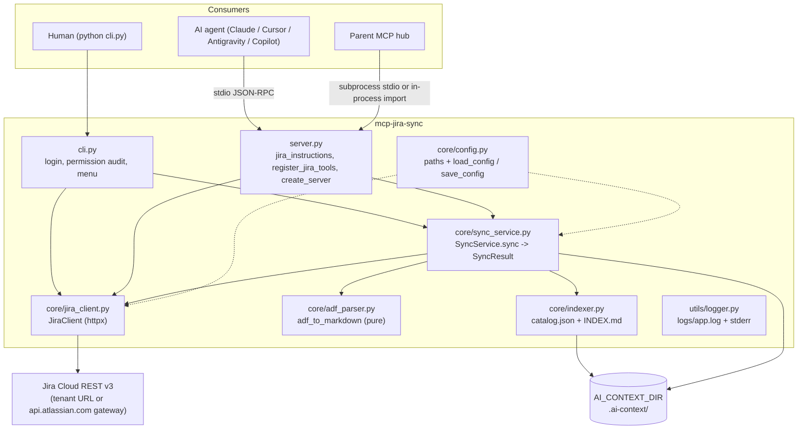
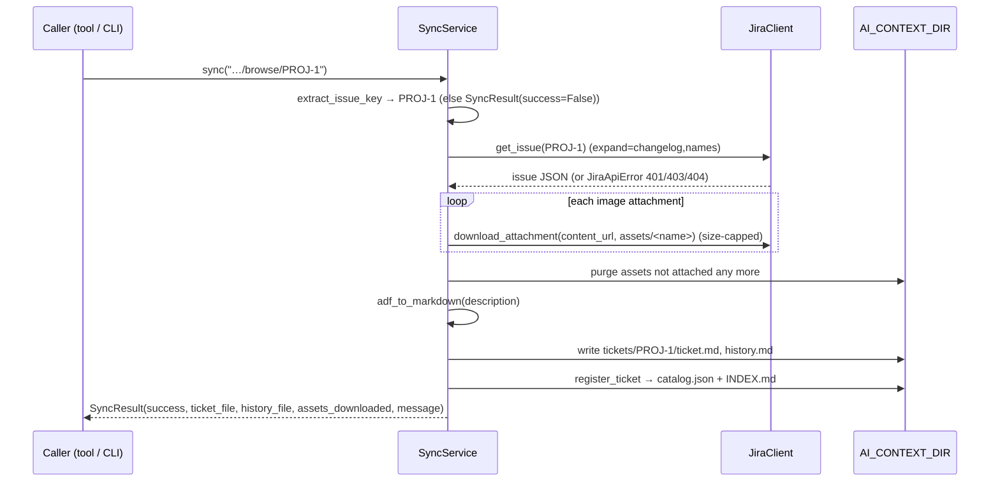

# Architecture

## 1. Topology

## 2. Sync pipeline (`SyncService.sync`)

Steps 1-8 in the code match this order. `sync()` catches every exception and returns a `SyncResult`; callers never need `try`.

## 3. Jira access strategy

`JiraClient` ([core/jira_client.py](../core/jira_client.py)) supports both classic API tokens (work on the tenant URL) and scoped API tokens (work only through the Atlassian gateway):

1. **Constructor**: for `*.atlassian.net`, `GET <base>/_edge/tenant_info` (8 s timeout, unauthenticated) → `cloudId`. If found, `api_url = https://api.atlassian.com/ex/jira/<cloudId>`; otherwise `api_url = base_url`.
2. **`verify_account`**: try `GET <base>/rest/api/3/myself` directly. On failure, and if a cloudId exists, try `GET <gateway>/rest/api/3/mypermissions?permissions=BROWSE_PROJECTS`; on success, use the gateway, and `/myself` if allowed, else a synthesized `"<name> (Scoped Token)"` user. Otherwise raise `JiraApiError(401)`.
3. **`get_issue`**: try `api_url`, then gateway, then direct (deduplicated). 401/403/404 move on to the next candidate; the last status decides the error.
4. **`download_attachment`**: stream the attachment `content` URL with redirects, abort past `MAX_ASSET_SIZE_MB`, and delete partial files.

Timeouts: tenant_info 8 s · myself/permissions 15 s · issue 25 s · attachment 30 s. No retries.

Auth: `Authorization: Basic base64(email:token)`. The token is never logged.

## 4. Configuration and paths

- `BASE_DIR` = repo root (from `__file__`). `.env` and `logs/` always live there.
- `AI_CONTEXT_DIR`: env > `.env` > `<repo>/.ai-context`, resolved once at import. See [AI_CONTEXT_FORMAT.md](AI_CONTEXT_FORMAT.md#1-location).
- Credentials: `load_config()` is called per sync/check (not cached), so a CLI login takes effect immediately. Priority and the central file: [JIRA_ACCESS.md](JIRA_ACCESS.md#3-configuration-sources-and-priority).

## 5. Process model

- **Standalone**: `python server.py` → `verify_environment` → `main()` → `setup_logging` → `create_server()` (mcp 2.x `MCPServer`, fallback mcp 1.x `FastMCP`, with `instructions=jira_instructions()`) → `register_jira_tools` → `run("stdio")`.
- **Mounted**: a Python hub imports `server` (no exit, no server start) and calls `register_jira_tools(hub_app, prefix)`. See [PARENT_MCP_GUIDE.md](PARENT_MCP_GUIDE.md).
- Tool calls are synchronous functions; each creates its own `SyncService` / `JiraClient`, so there is no shared state between calls (except the files in `AI_CONTEXT_DIR`).

## 6. Logging

`utils/logger.py`: logger `jira_sync.*`, file `logs/app.log` (DEBUG, rotating 10 MB × 3, format `%(asctime)s [%(levelname)s] [%(filename)s:%(lineno)d in %(funcName)s] %(message)s`, **frozen** so agents can parse it) + stderr console (INFO, `[LEVEL] message`). On a failed sync, an agent reads `logs/app.log` for the exact line and traceback.
